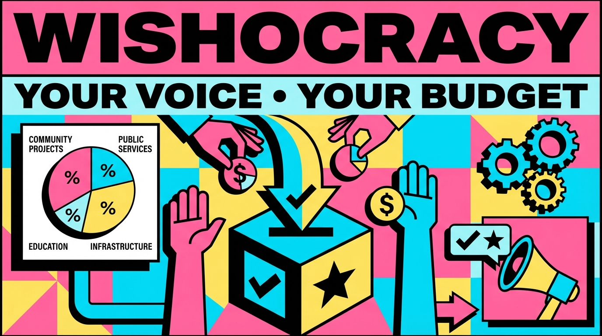

# Wishocracy

<p align="center">
  
</p>

**Wishocracy turns governance into a budget interface.**

Wishocracy is a working coordination app for public priorities. Instead of asking people to rank a giant list of issues or cast another yes/no vote, it asks them to make one tradeoff at a time, converts those judgments into a budget allocation, and aggregates them into a collective preference signal.

Built for **PL_Genesis: Frontiers of Collaboration**, Wishocracy is a concrete answer to the hackathon's focus on coordination, governance, and shared intelligence.

[Use the live app](https://wishocracy.org) | [Read the paper](https://wishocracy.warondisease.org/) | [Research DOI](https://doi.org/10.5281/zenodo.18523096) | [Run it locally](#run-locally)

## Why This Matters

Representative democracy has a principal-agent problem: elected officials face incentives that often diverge from citizen welfare, while most democratic interfaces are weak at expressing tradeoffs and preference intensity.

Polls tell you what people like. Elections tell you who they picked. Neither tells you what they would actually fund more, or fund less, when resources are limited.

Wishocracy does.

That makes it useful for:

- citizens who want to see what they would actually prioritize
- researchers measuring collective priorities
- advocates testing whether a message changes allocation, not just approval
- communities, DAOs, and public-interest organizations that need a better coordination mechanism

## How It Works

1. A participant chooses which budget categories they want considered.
2. Wishocracy presents pairwise tradeoffs such as allocating `$100` between two priorities.
3. Those responses are aggregated into a percentage allocation across the full set.
4. The participant sees their own result alongside the community average and current government spending.
5. The result can be saved, revisited, and shared through a referral link.

This is not just a ranking tool. It is a budget allocation interface that captures both direction and intensity.

## Why Pairwise Works Better

The core RAPPA insight is that humans are much better at making one constrained comparison at a time than producing a clean ranking across a long list.

That gives Wishocracy three practical advantages:

- lower cognitive load than ranking many priorities at once
- stronger signal because it captures intensity, not just order
- tractable participation because the paper targets roughly `10-30` comparisons in about `5-10 minutes`

The research framing also gives the project credible precedent: participatory budgeting in **Porto Alegre**, digital democracy work in **Taiwan**, and aggregation research built on pairwise comparison methods.

## Why This Fits PL_Genesis

PL_Genesis is about building tools for coordination, governance, and shared intelligence. Wishocracy fits that directly:

- it turns subjective public values into a structured, aggregatable signal
- it lets many people contribute small judgments that add up to a collective budget
- it makes governance legible by showing `YOU`, `AVG`, and `GOVT` side by side
- it is already a working product, not a concept deck
- it creates a path from collective intelligence to accountability, not just visualization

Given the hackathon's two main competition tracks, Wishocracy is a strong fit for **Existing Code**: the core system already exists, and this repo is focused on shipping meaningful product improvements that make the experience usable now.

## What People Can Do Right Now

The current app already supports a full end-to-end loop:

1. Start without creating an account.
2. Choose which of the 10 budget areas you want included.
3. Compare priorities two at a time using explicit budget tradeoffs.
4. See your own allocation across the selected categories.
5. Compare your result against the community average and current government spending.
6. Sign in to save your allocations and sync guest progress.
7. Share a referral link so other people can run the same flow.

The current category set includes examples like pragmatic clinical trials, addiction treatment, early childhood education, drug war enforcement, prison operations, and military systems.

## Why Judges Should Care

This project is immediately legible as a coordination primitive:

- it measures what people would actually allocate under constraint
- it produces outputs that can be compared, debated, and acted on
- it can scale from a single issue set to broader public budgeting problems
- it has a clear path from prototype to public accountability infrastructure

The paper's proposed rollout is especially strong:

- **Phase 1:** publish a public **Preference Gap Report** showing the difference between citizen allocations and actual government allocations
- **Phase 2:** publish **Citizen Alignment Scores** showing which politicians actually vote in line with those preferences

That gives Wishocracy a credible roadmap from demo to institutionally relevant system.

## Product Thesis

Wishocracy is trying to collect better budget signals.

The goal is to make tradeoffs visible, comparable, and aggregatable so governance can be based on what people would actually allocate under constraint, not just what they endorse in the abstract.

## Repository

- `packages/web`: Next.js app powering the live Wishocracy experience
- `packages/rappa`: RAPPA calculation engine for pairwise aggregation and scoring
- `packages/db`: Prisma schema and shared database package

## Run Locally

Requirements:

- `pnpm`
- Postgres
- environment variables based on `packages/web/.env.example`

From the repo root:

```bash
pnpm install
pnpm --filter @wishocracy/web db:up
pnpm --filter @wishocracy/web dev
```

Useful commands:

```bash
pnpm --filter @wishocracy/web typecheck
pnpm --filter @wishocracy/web test
pnpm --filter @wishocracy/web db:migrate
pnpm --filter @wishocracy/web db:studio
```

## Contact

- App: `https://wishocracy.org`
- Paper: `https://wishocracy.warondisease.org/`
- Email: `hello@wishocracy.org`
